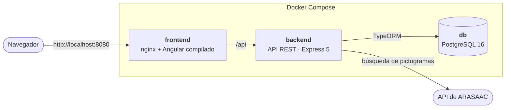
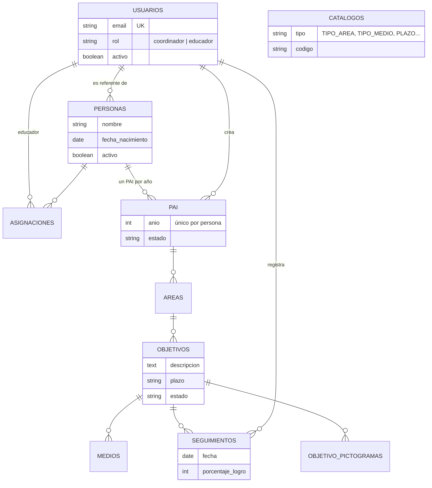
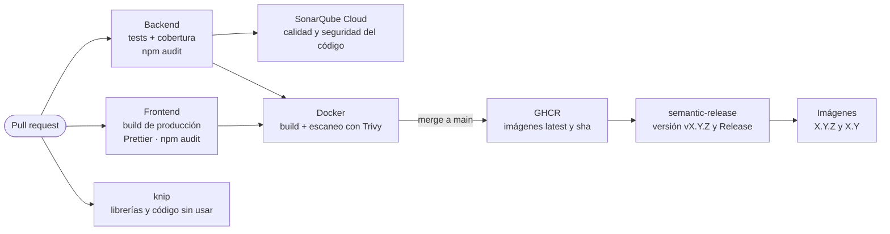

# piaManager

[](https://github.com/AngelaIruzubi/piaManager/actions/workflows/ci.yml)
[](https://sonarcloud.io/summary/new_code?id=AngelaIruzubi_piaManager)
[](https://github.com/AngelaIruzubi/piaManager/releases)

Aplicación web full stack para gestionar **Plan Individualizado de Atención (PIA)** en centros sociales y educativos.

Nace de mis dos años como educadora social. En los centros, los PAI suelen vivir en documentos sueltos y hojas de cálculo: cuesta saber qué objetivos tiene cada persona, quién trabaja con ella y cómo va avanzando. piaManager reúne en un solo lugar a las personas usuarias, sus planes, sus objetivos y el seguimiento diario del equipo educativo, con pictogramas para que los objetivos también sean comprensibles para la propia persona.

**Angular 21 · Node.js 24 + Express 5 · TypeScript · PostgreSQL 16 · Docker · GitHub Actions**

---

## Contenido

- [Funcionalidades](#funcionalidades)
- [Tecnologías](#tecnologías)
- [Arquitectura](#arquitectura)
- [Modelo de datos](#modelo-de-datos)
- [Seguridad](#seguridad)
- [Calidad y DevOps](#calidad-y-devops)
- [Puesta en marcha](#puesta-en-marcha)
- [Tests](#tests)
- [Decisiones técnicas](#decisiones-técnicas)
- [Estructura del repositorio](#estructura-del-repositorio)
- [Próximos pasos](#próximos-pasos)

## Funcionalidades

La aplicación tiene dos roles: **coordinación** y **educadores**.

| | Coordinación | Educadores |
|---|:---:|:---:|
| Ver personas usuarias y sus fichas | Todas | Solo las asignadas |
| Dar de alta, editar y dar de baja personas | ✅ | |
| Asignar educadores a cada persona | ✅ | |
| Crear el PAI anual y cambiar su estado | ✅ | |
| Objetivos por área, con sus plazos y estados | ✅ | ✅ |
| Medios para conseguir cada objetivo | ✅ | ✅ |
| Seguimientos del progreso (% de logro y observaciones) | ✅ | ✅ |
| Pictogramas de [ARASAAC](https://arasaac.org) en los objetivos | ✅ | ✅ |
| Gestionar el equipo (altas y bajas de usuarios) | ✅ | |

## Tecnologías

| Parte | Tecnologías |
|---|---|
| **Frontend** | Angular 21 (*standalone*, *zoneless*, signals), TypeScript, SCSS, interceptor JWT y guards de rutas |
| **Backend** | Node.js 24, Express 5, TypeScript, TypeORM 1.1 con migraciones, class-validator, JWT y bcrypt |
| **Base de datos** | PostgreSQL 16 |
| **Tests** | Jest y ts-jest |
| **Infraestructura** | Docker (imágenes *multi-stage*), Docker Compose y nginx como proxy inverso |
| **CI/CD** | GitHub Actions, GitHub Container Registry, SonarQube Cloud, Trivy, knip, Prettier, Dependabot y semantic-release |

## Arquitectura

Con Docker Compose, la aplicación son tres contenedores. Solo nginx está abierto al exterior: sirve el frontend compilado y pasa las peticiones `/api` al backend. Así el navegador habla con un único origen y la API no queda expuesta.



El backend está organizado por capas: **rutas → middlewares → controladores → servicios → entidades**.

- Las **rutas** encadenan los middlewares de cada endpoint: autenticación, rol, acceso a la persona y validación del cuerpo.
- Los **controladores** solo traducen HTTP.
- La lógica de negocio vive en los **servicios**, que son los que se prueban con los tests.

## Modelo de datos

Diez tablas. Cada persona tiene como máximo **un PAI por año**. El PAI se divide en **áreas**, cada área tiene **objetivos**, y cada objetivo tiene sus **medios**, sus **seguimientos** y sus **pictogramas**.



`CATALOGOS` guarda los valores de las listas desplegables (tipos de área y de medio, plazos, estados y roles), así se pueden cambiar sin tocar el código.

## Seguridad

- **Autenticación**: contraseñas cifradas con **bcrypt** y sesión con **JWT**. Los usuarios dados de baja no pueden entrar. El backend no arranca si falta `JWT_SECRET`.
- **Autorización por rol**: el middleware `soloCoordinador` protege los endpoints de coordinación en el backend. En el frontend, los guards ocultan las pantallas, pero la protección real está en el servidor.
- **Autorización por recurso (contra IDOR)**: un educador solo puede ver y tocar a las personas que tiene asignadas. El middleware `accesoPersona` sube por la jerarquía (seguimiento → objetivo → área → PAI → persona) para comprobarlo en cada petición, aunque se cambie el id en la URL.
- **Validación de entrada**: cada cuerpo de petición se valida con un DTO de **class-validator** en modo lista blanca. Los campos que no están en el DTO se rechazan con un 400, así nadie puede colar en la petición datos que la pantalla no envía, como un `id` o una fecha de creación (*mass assignment*).
- **Errores controlados**:
  - Los errores tipados pasan por un manejador global que responde con el código HTTP correcto y sin detalles internos.
  - Los errores de PostgreSQL se traducen: una clave foránea inexistente da 404 y un duplicado da 409.
  - Los logs se limpian para evitar la inyección de líneas falsas.
- **Integridad de datos**: el PAI se crea dentro de una **transacción** (el plan y sus cinco áreas se guardan juntos o no se guarda nada) y una restricción única impide dos PAI para la misma persona y año.
- **Contenedores**:
  - Imágenes que no se ejecutan como root.
  - La imagen final del backend no lleva npm.
  - La base de datos y la API no están expuestas a internet.
  - nginx añade cabeceras de seguridad (`X-Content-Type-Options`, `X-Frame-Options`, `Referrer-Policy`).
  - CORS se limita al origen configurado.

## Calidad y DevOps

Cada pull request pasa por el CI de GitHub Actions. Al fusionar en `main`, el CI publica las imágenes Docker y, si hay cambios funcionales, crea una versión nueva sin intervención manual.



| Herramienta | Qué comprueba |
|---|---|
| **Jest** | Los tests unitarios del backend, con informe de cobertura |
| **SonarQube Cloud** | Bugs, vulnerabilidades, *security hotspots*, código duplicado y cobertura. Nota actual: **A** en fiabilidad, seguridad y mantenibilidad |
| **npm audit** | Vulnerabilidades conocidas en las librerías de producción |
| **Trivy** | Vulnerabilidades dentro de las imágenes Docker: librerías, sistema operativo (Alpine) y runtime. Los resultados aparecen en la pestaña *Security* de GitHub |
| **knip** | Dependencias, archivos y exportaciones que sobran |
| **Prettier** | Que el código del frontend sigue el formato acordado |
| **Dependabot** | Cada semana propone actualizaciones de librerías, imágenes base y acciones del CI. Las versiones mayores que rompen compatibilidad (Angular, TypeScript, Node) se actualizan a mano |
| **semantic-release** | Calcula la versión a partir de los mensajes de commit ([Conventional Commits](https://www.conventionalcommits.org/es/)) y publica la [Release](https://github.com/AngelaIruzubi/piaManager/releases) con la lista de cambios |

Las imágenes están publicadas en GitHub Container Registry:

```bash
docker pull ghcr.io/angelairuzubi/pia-backend:latest
docker pull ghcr.io/angelairuzubi/pia-frontend:latest
```

`main` está protegida: solo se puede fusionar un PR si pasan los tests, el build y la construcción de las dos imágenes.

## Puesta en marcha

### Opción A: todo con Docker (recomendada)

Solo hace falta [Docker](https://www.docker.com/products/docker-desktop/).

```bash
git clone https://github.com/AngelaIruzubi/piaManager.git
cd piaManager

# Variables: contraseña de la base de datos y clave de los JWT (cambia los valores)
cp .env.example .env

# Construye y arranca base de datos, backend y frontend
# (las migraciones se aplican solas al arrancar)
docker compose up -d --build

# Solo la primera vez: catálogos y usuaria coordinadora inicial
docker compose exec backend node dist/config/seed.js
```

Abre **http://localhost:8080** y entra con `admin@pia.com` / `admin123`.

Para pararlo: `docker compose down` (los datos se conservan en el volumen `pia_db_data`).

### Opción B: desarrollo en local

Requisitos: Node.js 24, npm 11 y Docker (para la base de datos).

```bash
# Variables de Docker (raíz) y del backend.
# La contraseña de la base de datos debe ser la misma en los dos archivos
cp .env.example .env
cp backend/.env.example backend/.env

# Dependencias de la raíz, del backend y del frontend
npm install
npm install --prefix backend
npm install --prefix frontend

# Arranca PostgreSQL en Docker y, a la vez, el backend y el frontend con recarga automática
npm run dev:db
```

- Frontend: **http://localhost:4200** · API: **http://localhost:3000/api**
- Solo la primera vez, en otra terminal: `npm run seed --prefix backend`

## Tests

```bash
cd backend
npm test                # 61 tests en 9 suites
npm run test:coverage   # con informe de cobertura (backend/coverage)
```

Hay tests unitarios de los servicios (autenticación, usuarios, PAI, objetivos, medios y seguimientos) y de los middlewares de seguridad (acceso por recurso, validación y manejo de errores). La base de datos se simula con *mocks*, así que no hace falta tenerla levantada.

## Decisiones técnicas

- **Migraciones en lugar de `synchronize`**: TypeORM puede crear las tablas solo, pero en producción eso puede borrar columnas sin avisar. Cada cambio del esquema es una migración versionada en git que se aplica al arrancar.
- **nginx como proxy inverso**: el frontend y la API comparten origen, así que no hace falta CORS en producción y el backend no se publica en ningún puerto.
- **Imágenes *multi-stage***: se compila con todas las herramientas y la imagen final solo lleva lo necesario para ejecutar. Pesa menos y tiene menos superficie de ataque.
- **Se publica lo mismo que se ha probado**: semantic-release no reconstruye las imágenes. Añade la etiqueta de versión a la imagen exacta que ya pasó los tests y Trivy.
- **Análisis en modo aviso**: SonarQube, Trivy, npm audit y knip informan sin bloquear el PR, para decidir qué arreglar con criterio. El siguiente paso es bloquear ante vulnerabilidades críticas.
- **Versiones fijadas cuando hace falta**: Angular 21 exige versiones concretas de TypeScript y Vitest, y Dependabot está configurado para no proponer saltos que rompan esa compatibilidad. Las vulnerabilidades de dependencias internas se corrigen con `overrides` de npm mientras llega el parche oficial de Angular.
- **Angular moderno de forma progresiva**: la app funciona sin Zone.js. Los componentes nuevos usan signals, `input()` y el nuevo control de flujo (`@if`, `@for`); los antiguos se migran poco a poco.

## Estructura del repositorio

```
piaManager/
├── backend/
│   ├── src/
│   │   ├── routes/        # Endpoints y cadena de middlewares
│   │   ├── middlewares/   # JWT, roles, acceso por recurso, validación y errores
│   │   ├── controllers/   # Traducción HTTP ↔ servicios
│   │   ├── services/      # Lógica de negocio
│   │   ├── entities/      # Modelos de TypeORM
│   │   ├── dtos/          # Validación de entrada (class-validator)
│   │   ├── migrations/    # Cambios del esquema de la base de datos
│   │   ├── config/        # Conexión a la base de datos y seed
│   │   └── tests/
│   └── Dockerfile
├── frontend/
│   ├── src/app/
│   │   ├── core/          # Servicio de autenticación, guards e interceptor
│   │   ├── features/      # auth, personas, pai y usuarios
│   │   └── shared/        # Componentes y modelos compartidos
│   ├── nginx.conf
│   └── Dockerfile
├── .github/
│   ├── workflows/ci.yml   # CI/CD
│   └── dependabot.yml
├── docker-compose.yml
└── sonar-project.properties
```

## Próximos pasos

- [ ] Despliegue con URL pública y usuarios de demo de los dos roles.
- [ ] Datos de demo ficticios y capturas de pantalla en este README.
- [ ] Sesión más robusta: comprobar la caducidad del token y volver al login ante un 401.
- [ ] Tests de integración de la API con Supertest (login, permisos, validación).
- [ ] Tests del frontend (guards, interceptor y servicio de autenticación) y su cobertura en SonarQube.
- [ ] Terminar la migración a signals y al nuevo control de flujo de Angular.
- [ ] Documentación de la API con Swagger/OpenAPI.
- [ ] Accesibilidad medida con Lighthouse.
- [ ] **Indicadores para coordinación**: evolución de cada persona usuaria (porcentaje de objetivos conseguidos por área y progreso de los seguimientos en el tiempo).
- [ ] **Métricas de uso**: usuarios activos, seguimientos registrados por semana y PAI pendientes de revisión, en un panel para coordinación.
- [ ] **Observabilidad**:
  - Logs estructurados en JSON (pino), con un identificador por petición para seguirla de principio a fin.
  - Métricas de la API (peticiones, errores y tiempos de respuesta) con Prometheus y un panel en Grafana.
  - Alertas si la aplicación deja de responder.

## Autora

**Ángela Iruzubieta** · Desarrolladora Full Stack Junior, antes educadora social

[LinkedIn](https://linkedin.com/in/angela-iruzubieta) · [GitHub](https://github.com/AngelaIruzubi)
